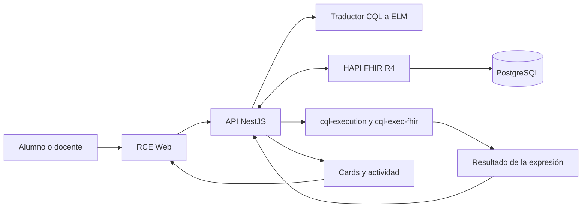
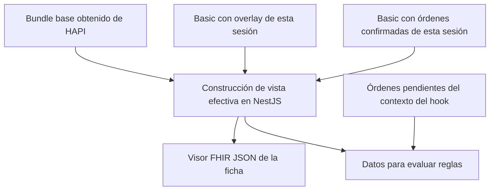

# Aprende a explicar y demostrar el RCE-CQL

> Catálogo actualizado el 3 de noviembre de 2026: los ejemplos anteriores de alergia y diabetes al ordenar ya no están en el selector. Este documento conserva esas explicaciones como material de estudio. Para la demo actual usa el [libreto con las cuatro plantillas vigentes](./LIBRETO_DEMO_PASO_A_PASO.md).


Guía de estudio y presentación · 29 de octubre de 2026

Basada en el código local de `RCE-CQL`, sobre el commit `91e3bc4` y los cambios presentes en el workspace, incluido el visor FHIR JSON. Describe la implementación inspeccionada; no certifica el comportamiento de un servidor desplegado. Los casos son sintéticos y sus reglas son ejercicios de programación clínica, no protocolos asistenciales.

## Cómo trabajar con esta guía

El objetivo es que puedas **explicar qué ocurre, mostrar la evidencia y predecir qué cambiará al modificar un dato**. Memorizar siglas no alcanza.

Usaremos este ciclo de aprendizaje:

1. **Comprender:** leer una explicación corta y relacionarla con una pantalla.
2. **Ver un ejemplo resuelto:** seguir un dato desde FHIR hasta la card.
3. **Predecir:** anticipar el resultado antes de tocar el sistema.
4. **Comprobar:** ejecutar un cambio controlado e inspeccionar JSON y actividad.
5. **Explicar sin mirar:** contarlo con tus palabras durante un minuto.
6. **Recibir feedback:** una pregunta por turno; corregir una confusión antes de subir de dificultad.

Recorrido recomendado: bloques 1–3 para comprender la arquitectura; 4–6 para leer FHIR; 7–9 para seguir la ejecución; 10–12 para ensayar. No necesitas estudiar todo de una vez. Repite la explicación de memoria al día siguiente y unos días después; el repaso debe centrarse en lo que te costó justificar.

| Etapa | Resultado observable de aprendizaje |
| --- | --- |
| Vocabulario | Distingues HL7, FHIR, HAPI, CQL, ELM y CDS Hooks sin intercambiarlos. |
| Datos | Reconoces un recurso, su paciente, código, estado, valor y fecha. |
| Ejecución | Sigues el camino desde una regla hasta una card. |
| Experimentación | Predices un caso positivo y otro negativo y explicas discrepancias. |
| Presentación | Haces una demo de 20 minutos y contestas objeciones técnicas. |

## 1. La explicación que debes dominar primero

> Este RCE educativo permite escribir reglas CQL, traducirlas a ELM y guardarlas como recursos Library en HAPI FHIR. Cuando se abre una ficha o se revisan órdenes, NestJS reúne los datos FHIR del paciente y los cambios privados del sandbox. Un motor CQL existente evalúa la expresión configurada. Si devuelve exactamente verdadero, la aplicación construye una card de soporte a decisiones. Cada alumno puede experimentar sin cambiar el paciente base de los demás.

Tres ideas sostienen toda la presentación:

- **Datos:** los recursos FHIR describen hechos, solicitudes y contexto.
- **Lógica:** CQL expresa las condiciones; ELM representa esa lógica para ejecutarla.
- **Momento:** CDS Hooks identifica cuándo pedir soporte a decisiones y cómo responder.

Ejemplo: “HbA1c 7,2 %” es un dato. “Existe una HbA1c final de al menos 6,5” es una condición de la plantilla. “Al abrir la ficha” es el momento. “Se cumplen cuatro criterios” es el mensaje mostrado si la regla compuesta aplica.

## 2. Qué significa cada nombre

| Nombre | Qué es | Papel en esta demo |
| --- | --- | --- |
| HL7 | Organización que desarrolla estándares de interoperabilidad sanitaria. | FHIR y CQL pertenecen a ese ecosistema. |
| FHIR | Estándar de recursos, tipos de datos e interacciones. | La aplicación usa **R4, versión 4.0.1**. |
| HAPI FHIR | Implementación de tecnología FHIR. | Servidor que almacena y entrega recursos por HTTP. |
| CQL | Lenguaje para expresar lógica clínica. | El alumno escribe las reglas. |
| ELM | Modelo estructurado de la lógica, representable en JSON/XML. | El traductor produce ELM JSON y el motor lo consume. |
| CDS Hooks | Especificación de invocación de servicios de apoyo a decisiones. | La API expone servicios para tres momentos del flujo. |
| NestJS | Framework del backend TypeScript. | Coordina sesión, datos, traducción, ejecución y respuesta. |
| React / Vite / Monaco | Interfaz, herramientas de frontend y editor. | Presentan la ficha y permiten escribir CQL. |
| Synthea | Generador de pacientes sintéticos utilizado por el proyecto. | Proporciona datos docentes; no participa en cada evaluación. |
| PostgreSQL | Persistencia interna del HAPI administrado por el proyecto. | La API del RCE no consulta sus tablas. |

FHIR permite representar recursos en JSON; **un JSON cualquiera no se vuelve FHIR por ser JSON**. Debe respetar tipos, campos, cardinalidades y reglas del estándar, además del perfil acordado cuando corresponda. [Introducción oficial a FHIR R4](https://hl7.org/fhir/R4/overview.html).

### HL7 v2 y FHIR son distintos

En un hospital puedes encontrar mensajes HL7 v2 con segmentos como `MSH`, `PID` u `OBX`. Este repositorio trabaja con recursos FHIR por API; no demuestra un receptor de mensajes v2. En una integración hospitalaria podría existir un adaptador que transforme resultados v2 a FHIR, con mapeos y validación explícitos. Ese adaptador no está implementado aquí. Tampoco debe asumirse una correspondencia automática de un segmento a un único recurso. [Comparación oficial FHIR–v2](https://hl7.org/fhir/R4/comparison-v2.html).

## 3. Arquitectura: quién hace qué



**HAPI guarda; el traductor traduce; el motor evalúa; NestJS coordina.** En esta implementación el motor se ejecuta dentro del proceso del backend. No hay que afirmar que HAPI ejecuta la regla mediante `$apply`.

El navegador consume la API del RCE. La API usa adaptadores para hablar con HAPI y con el traductor. Esa separación permite cambiar una integración sin obligar a la interfaz a conocer sus detalles.

Versiones fijadas en el código/configuración consultados: `cql-execution` 3.3.2, `cql-exec-fhir` 2.1.6 y traductor `v2.9.0`; el modelo de datos usado por el motor es `FHIRv401`. Estos números identifican productos diferentes: no son versiones intercambiables del estándar CQL o FHIR. La especificación CQL publicada en la web puede ser posterior a las capacidades del runtime fijado.

### Dos recorridos que debes poder dibujar

**Autoría:** escribir CQL → guardar borrador → traducir/validar → ver ELM → probar con un paciente → publicar/activar → guardar el artefacto en `Library`.

**Uso:** abrir ficha o revisar órdenes → resolver sandbox → recuperar reglas y datos → construir datos efectivos → evaluar ELM → convertir `true` en card → mostrar y registrar actividad cuando corresponda.

La traducción no implica que exista una card. Una regla puede traducir correctamente y dar `false`, no tener los datos necesarios o fallar al ejecutarse con una combinación no soportada.

## 4. Cómo leer un recurso FHIR sin perderte

Lee siempre en este orden: **tipo → identidad → paciente → significado → estado → valor → tiempo**.

Este ejemplo es didáctico, creado para la guía; no se extrajo de un paciente real ni de un servidor activo:

```json
{
  "resourceType": "Observation",
  "id": "demo-hba1c",
  "status": "final",
  "code": {
    "coding": [{
      "system": "http://loinc.org",
      "code": "4548-4",
      "display": "Hemoglobin A1c/Hemoglobin.total in Blood"
    }]
  },
  "subject": { "reference": "Patient/demo-paciente" },
  "effectiveDateTime": "2026-10-20T09:00:00-03:00",
  "valueQuantity": {
    "value": 7.2,
    "unit": "%",
    "system": "http://unitsofmeasure.org",
    "code": "%"
  }
}
```

| Elemento | Cómo interpretarlo en voz alta |
| --- | --- |
| `resourceType` | “Esto representa una observación.” |
| `id` | “Es su identificador lógico en el contexto del servidor.” |
| `subject.reference` | “Esta observación corresponde a este Patient.” |
| `code.coding` | “El concepto medido se identifica mediante sistema y código.” |
| `status` | “El resultado está marcado como final.” |
| `valueQuantity` | “El valor es 7,2, con unidad porcentual codificada.” |
| `effectiveDateTime` | “Es la fecha clínica de la observación.” |

No confundas `id` con `identifier`: el primero identifica el recurso; el segundo puede expresar un identificador de negocio, como un número de ficha, acompañado de su sistema. Tampoco confundas `meta.versionId`, revisión técnica del recurso, con `Library.version`, versión de negocio del artefacto.

`Coding` representa un código; `CodeableConcept` puede agrupar codificaciones y texto. `Quantity` agrega valor y unidad. `Reference` conecta recursos. `value[x]` indica una elección de tipo: en JSON aparece un nombre concreto como `valueQuantity` o `valueString`. El sufijo `[x]` no se escribe literalmente en el JSON. [Tipos de datos FHIR](https://hl7.org/fhir/R4/datatypes.html).

### Un estado siempre necesita su recurso

`Condition.clinicalStatus=active` habla de la vigencia del problema; `Observation.status=final` del estado del resultado; `MedicationRequest.status=active` de la solicitud. No significan lo mismo. `Patient.active` indica que el registro está en uso; no dice que una enfermedad esté activa ni que el paciente esté vivo.

### Fechas que cumplen funciones diferentes

En la ficha compara `birthDate` del paciente, `effectiveDateTime` del resultado y `authoredOn` de una solicitud. La fecha de actualización técnica no reemplaza a la fecha clínica. Una regla que no consulta fechas no adquiere una ventana temporal por el simple hecho de que los datos tengan fechas.

## 5. Diccionario de los recursos utilizados

### Patient: la persona que recibe atención

Contiene identificación y datos demográficos/administrativos. Mira `name`, `identifier`, `birthDate` y `gender`; este último es sexo/género administrativo del recurso y no debe interpretarse automáticamente como toda la información clínica sobre sexo. La edad de la plantilla se calcula a partir de la fecha de nacimiento. Los diagnósticos y resultados se representan en recursos relacionados, no como una lista de campos arbitrarios de Patient. [Patient R4](https://hl7.org/fhir/R4/patient.html).

**En la demo:** cambia la fecha de nacimiento y vuelve a inspeccionar `Patient` en FHIR JSON. Explica que ves la versión efectiva del sandbox.

### Observation: un resultado o una observación

Representa mediciones y afirmaciones simples. Mira `code`, `status`, `subject`, `effective[x]`, `value[x]` y, cuando corresponda, `component`. Un valor alto no crea por sí solo un diagnóstico. Una presión puede representarse con componentes; los overlays rápidos del proyecto generan observaciones separadas para sistólica y diastólica. Una regla escrita solo para una de esas estructuras puede no cubrir la otra. [Observation R4](https://hl7.org/fhir/R4/observation.html).

**En la demo:** identifica código LOINC, valor, unidad y fecha de HbA1c. Señala si procede del dato base o del ejercicio cuando puedas determinarlo.

### Condition: un problema o condición clínica

Inspecciona `code`, `clinicalStatus`, `verificationStatus`, `subject` y fechas como `onset[x]`. “Activo” describe vigencia; “confirmado” expresa verificación. Son ejes distintos. [Condition R4](https://hl7.org/fhir/R4/condition.html).

**En el código:** la plantilla compara SNOMED CT `44054006`, concepto de diabetes mellitus tipo 2, aunque parte de la interfaz use la etiqueta abreviada “diabetes mellitus”. El texto mostrado no amplía el conjunto de códigos que reconoce la regla.

### MedicationRequest: solicitud de medicamento

Mira `medicationCodeableConcept` o `medicationReference`, `status`, `intent`, `subject`, `authoredOn` y `dosageInstruction`. Representa una solicitud, no prueba de administración o adherencia. [MedicationRequest R4](https://hl7.org/fhir/R4/medicationrequest.html).

**En esta demo:** se usa la variante `medicationCodeableConcept` con RxNorm. Las plantillas consultan esa variante; no resuelven automáticamente un recurso `Medication` referenciado. La expresión “MetforminaActiva” significa que encontró una solicitud activa con el código exacto esperado.

### ServiceRequest: solicitud de servicio

Representa la petición de un examen, procedimiento u otro servicio. Mira `status`, `intent`, `code`, `subject` y `authoredOn`. Una solicitud de HbA1c no contiene necesariamente el resultado medido. [ServiceRequest R4](https://hl7.org/fhir/R4/servicerequest.html).

**En la demo:** la orden pendiente de HbA1c llega al hook; después de confirmar se muestra activa en el sandbox. Eso no genera una nueva HbA1c de laboratorio.

### AllergyIntolerance: riesgo de reacción adversa

Mira `code`, `clinicalStatus`, `verificationStatus`, `patient` y, si existe, `reaction`. Aquí la referencia al paciente está en `patient`, no en `subject`. La ausencia de un recurso no demuestra ausencia de alergias. [AllergyIntolerance R4](https://hl7.org/fhir/R4/allergyintolerance.html).

**En la demo:** la plantilla busca el código SNOMED `91936005` y un estado clínico activo junto con la selección de amoxicilina. No implementa una base completa de interacciones ni de reactividad cruzada.

### Encounter: el episodio de atención

Representa una interacción de atención y su contexto. Mira `status`, `class`, `subject` y `period`. No equivale al paciente ni a una cita agendada. [Encounter R4](https://hl7.org/fhir/R4/encounter.html).

**En la demo:** aporta contexto de atenciones en la ficha. Estar presente en la ficha no significa que todas las reglas lo utilicen.

### Procedure: evento de procedimiento

Mira `status`, `code`, `subject` y `performed[x]`. Es un recurso de evento: puede describir un procedimiento realizado, en curso o no realizado, según su estado. No basta con ver `Procedure` para afirmar que se completó. [Procedure R4](https://hl7.org/fhir/R4/procedure.html).

**En la demo:** ordenar un procedimiento genera una `ServiceRequest`; no debe presentarse como un procedimiento ya efectuado.

### Immunization: evento de inmunización

Mira `status`, `vaccineCode`, `patient` y `occurrence[x]`; pueden aparecer lote, dosis y fabricante. El estado importa: un registro de inmunización puede señalar que no se administró. [Immunization R4](https://hl7.org/fhir/R4/immunization.html).

**En la demo:** las inmunizaciones pueden mostrarse y editarse mediante el flujo guiado. No se presupone una regla de vacunas publicada por defecto.

### Library: conocimiento computable

Guarda contenido de conocimiento, como lógica CQL/ELM. Observa `name`, `version`, `status`, `type` y `content`. El RCE utiliza adjuntos `text/cql` y `application/elm+json` con datos Base64; Base64 es codificación, no cifrado. [Library R4](https://hl7.org/fhir/R4/library.html).

**Particularidad del proyecto:** hook, expresión, resumen, indicador, activación y ciclo editorial se guardan mediante extensiones propias. `validated` y `published` son estados de la aplicación, no valores que debas copiar sin más a `Library.status`. El mapper los traduce y conserva el ciclo local en una extensión.

### Basic: soporte de datos propios del sandbox

FHIR ofrece `Basic` para conceptos que no tienen una representación más específica aplicable en el caso de uso, mediante código y extensiones. [Basic R4](https://hl7.org/fhir/R4/basic.html).

**Aquí tiene tres usos verificables:** overlay de cambios del paciente, actividad CDS y revisiones/confirmaciones de órdenes. Esos significados son convenciones del RCE. Otro cliente FHIR que lea un `Basic` no entenderá automáticamente cómo reconstruir nuestro sandbox.

### Bundle: conjunto de recursos con un propósito

El tipo determina su uso: `searchset` para resultados de búsqueda, `collection` para una colección, `transaction` para solicitar operaciones atómicas y `batch` para operaciones independientes. No todo Bundle es una transacción. [Bundle R4](https://hl7.org/fhir/R4/bundle.html).

**Aquí:** `$everything` devuelve un Bundle; `draftOrders` usa una colección de órdenes. Construir un Bundle en memoria para evaluar no equivale a guardarlo como recurso ni a enviarlo como transacción.

### CapabilityStatement y OperationOutcome

`CapabilityStatement`, obtenido por `/metadata`, describe capacidades del servidor. El health check inspeccionado exige FHIR `4.0.1` y disponibilidad de `Patient`, `Library` y `Basic`. Eso no verifica por sí solo todos los permisos de escritura o todos los flujos. [CapabilityStatement R4](https://hl7.org/fhir/R4/capabilitystatement.html).

`OperationOutcome` representa incidencias de una interacción, con `issue`, severidad y detalles. No es una card clínica. El adaptador actual detecta errores HTTP y rechaza un OperationOutcome como si fuera el recurso solicitado; no hay que prometer que todos sus diagnósticos llegan íntegros a la interfaz. [OperationOutcome R4](https://hl7.org/fhir/R4/operationoutcome.html).

### Nombres que podrían aparecer en una discusión técnica

`Practitioner` y `PractitionerRole` identifican profesional y rol; el contrato CDS acepta esas formas en `context.userId`, y el flujo interno usa `Practitioner/rce-educativo`. Esa cadena no demuestra que exista un profesional persistido o autenticado institucionalmente.

`DiagnosticReport`, `MedicationAdministration`, `MedicationDispense`, `PlanDefinition`, `Provenance`, `AuditEvent`, `Task`, `ValueSet` y `CodeSystem` sirven para discutir una integración más amplia. No deben presentarse como recursos que la demo crea en todos sus flujos. El diseño incluye capacidades futuras que aún no están implementadas o verificadas. Consulta el [índice oficial de recursos](https://hl7.org/fhir/R4/resourcelist.html) al ampliar el alcance.

## 6. Terminología: por qué un texto bonito no basta

En las plantillas inspeccionadas, las comparaciones clínicas usan **sistema + código**. Cambiar el texto visible no convierte un código diferente en el esperado.

| Sistema usado por el proyecto | Ejemplos del código | Papel |
| --- | --- | --- |
| LOINC: `http://loinc.org` | `4548-4`, `8480-6`, `8462-4` | HbA1c, presión sistólica y diastólica. |
| SNOMED CT: `http://snomed.info/sct` | `44054006`, `91936005` | Condición usada para diabetes tipo 2 y alergia usada por la plantilla. |
| RxNorm: `http://www.nlm.nih.gov/research/umls/rxnorm` | `860975`, `308182` | Productos concretos de metformina y amoxicilina usados en el catálogo. |
| UCUM: `http://unitsofmeasure.org` | `%`, `mg/dL`, `mm[Hg]` | Unidades computables de las observaciones. |

Los códigos de la tabla están tomados de la implementación, no constituyen un catálogo clínico exhaustivo. Un `CodeSystem` define conceptos; un `ValueSet` selecciona un conjunto para un uso. Poner una URI de sistema en `coding.system` no demuestra que el servidor aloje el recurso CodeSystem ni que expanda ValueSets. [Terminología en FHIR](https://hl7.org/fhir/R4/terminologies.html).

Las extensiones tienen una URL identificadora y un valor tipado. Una extensión propia puede ser válida como mecanismo, pero necesita una definición compartida para interoperar. Las URI bajo `https://rce-cql.local/fhir/StructureDefinition/…` son convenciones de este proyecto; no son campos universales de HL7. Un perfil puede restringir cardinalidades, tipos y terminologías de un recurso base. [Extensiones FHIR](https://hl7.org/fhir/R4/extensibility.html).

## 7. Ejemplo resuelto: de cuatro hechos a una card

Caso didáctico: fecha de nacimiento `1980-01-01`, Condition activa con el código de la plantilla, HbA1c final de 7,2 % y MedicationRequest activa con RxNorm `860975`.

| Hecho | Recurso/campo inspeccionado | Expresión de la plantilla | Resultado esperado bajo esas condiciones |
| --- | --- | --- | --- |
| Adulto | `Patient.birthDate` | `EsAdulto` | `true` |
| Diabetes activa | `Condition.code` y `clinicalStatus` | `DiabetesActiva` | `true` |
| HbA1c elevada | `Observation.code`, `status`, `valueQuantity` | `HbA1cElevada` | `true` |
| Solicitud activa de metformina | `MedicationRequest.medicationCodeableConcept` y `status` | `MetforminaActiva` | `true` |

La plantilla termina así:

```cql
define "Aplica":
  "EsAdulto" and "DiabetesActiva" and "HbA1cElevada" and "MetforminaActiva"
```

Este fragmento procede del código local. La regla completa está en [el fixture CQL](../spikes/m0/fixtures/cql/RceComplexDiabetesFourFacts.cql) y en [las plantillas del backend](../apps/api/src/modules/cds-hooks/application/order-rule-templates.ts).

### Lectura de la expresión de HbA1c

```cql
define "HbA1cElevada":
  exists ([Observation] O
    where exists (O.code.coding CodingEntry
      where CodingEntry.system.value = 'http://loinc.org'
        and CodingEntry.code.value = '4548-4')
      and O.status.value = 'final'
      and (O.value as FHIR.Quantity).value.value >= 6.5)
```

Léelo así: “Entre las observaciones de este paciente, existe al menos una con el sistema y código buscados, estado final y valor numérico suficiente”.

`[Observation]` recupera recursos del contexto del paciente; `O` es un alias. El `exists` interno recorre las codificaciones. `O.value` es la elección de valor del modelo FHIR; el cast la trata como Quantity. El siguiente `.value` accede a la magnitud FHIR y el último al valor primitivo que usa esta representación del modelo. No significa que el JSON tenga tres campos llamados value anidados de esa forma.

### Lo que la regla hace y lo que debes revisar al presentarla

La implementación compara el número con 6,5, pero esa expresión **no comprueba la unidad**, ni selecciona el resultado más reciente, ni limita la antigüedad. Por eso el caso docente prepara explícitamente una HbA1c en porcentaje. El umbral pertenece al ejercicio; esta guía no lo convierte en una recomendación clínica.

También busca códigos exactos de medicamento y condición. No reconoce automáticamente todos los sinónimos, presentaciones o conceptos equivalentes. No comprueba toma efectiva del medicamento. Estos límites salen de leer la plantilla, no de una falla del estándar.

### Experimento controlado

Con todos los hechos verdaderos, predice que habrá card. Cambia solo la fecha de nacimiento a `2012-01-01`: `EsAdulto` pasa a falso y la conjunción deja de aplicar. Restaura la fecha y comprueba la recuperación de la card.

Es una primera prueba más controlable que bajar HbA1c: el bundle base podría tener otra HbA1c histórica alta. Como la plantilla usa `exists`, cualquier observación coincidente puede mantener el resultado verdadero. Los overlays no borran indiscriminadamente recursos base con otros identificadores.

### Ausencia de datos no equivale a normalidad

CQL puede producir `null`. `Coalesce(AgeInYears() >= 18, false)` establece una decisión explícita para un dato ausente en esta plantilla. En el backend, solo `value === true` produce card; `null` o `undefined` producen una advertencia de que la expresión no dio resultado. `false` significa otra cosa: la expresión sí produjo falso. [Guía de autor CQL](https://cql.hl7.org/02-authorsguide.html).

## 8. De CQL a ELM, Library y ejecución

Ejemplo inicial recomendado:

```cql
library RceEdad version '0.1.0'
using FHIR version '4.0.1'
context Patient
define "Aplica": AgeInYears() >= 18
```

`library` nombra el artefacto; `using` selecciona el modelo; `context` establece el paciente; `define` crea la expresión. El RCE administra el versionado y normaliza el encabezado; no tienes que inventar una versión manual para cada clic.

ELM conserva la lógica en un modelo estructurado, no los resultados clínicos. Puedes reconocer operaciones y expresiones en su JSON; no es necesario memorizar el documento completo. Traducir no ejecuta la regla contra todos los pacientes. [Semántica de traducción CQL–ELM](https://cql.hl7.org/06-translationsemantics.html).

| Acción de pantalla | Qué ocurre en el código inspeccionado | Evidencia para mostrar |
| --- | --- | --- |
| Guardar | Persiste Library con CQL y metadatos. | Borrador disponible al volver a abrir. |
| Validar | Envía CQL al traductor y guarda ELM. | Diagnósticos o vista ELM. |
| Probar | Ejecuta una regla sobre los datos efectivos de un paciente. | Resultado y cards de la prueba. |
| Publicar | Exige estado validado, ajusta versión, vuelve a traducir y guarda publicada/activa. | Estado, versión y alcance. |
| Activar/desactivar | Controla participación en la evaluación del hook. | Catálogo y número de reglas evaluadas. |

El método de ejecución usa esta secuencia real:

```text
leer ELM de Library (o traducir si no está disponible)
new cql.Library(JSON.parse(elmText))
new cql.Executor(library, undefined, parameters)
cqlfhir.PatientSource.FHIRv401()
patientSource.loadBundles([bundle])
executor.exec_expression(nombreExpresion, patientSource, ...)
leer el resultado de ese paciente
applies = value === true
```

La comprobación TypeScript final no reemplaza a la regla clínica: comprueba la salida del motor. El resumen y detalle de la card vienen de los metadatos de la regla; no son una explicación generada automáticamente de cada operación CQL.

El executor no recibe un servicio terminológico en ese argumento, ni el constructor de Library un resolver completo de dependencias. Las plantillas actuales trabajan con comparaciones explícitas. No prometas soporte arbitrario de `include`, FHIRHelpers o ValueSets porque una especificación los contemple. Tampoco presentes la validación como una comprobación clínica o como una garantía completa de que la expresión configurada existe y tiene el tipo esperado: hay requisitos de inspección ELM aún pendientes en el plan.

## 9. Sandbox y datos efectivos: el detalle que cambia la explicación

Imagina un libro compartido con anotaciones privadas de cada alumno. El libro es el paciente base; las anotaciones son el overlay. La analogía ayuda, pero técnicamente hay recursos y reglas de composición:



1. La cookie firmada permite al backend resolver el sandbox.
2. `Patient/{id}/$everything` obtiene datos base.
3. Nest clona el Bundle y aplica los cambios privados.
4. Los valores editados se materializan como campos o recursos FHIR en memoria.
5. Las revisiones de órdenes confirmadas se leen de Basic y se materializan como solicitudes activas.
6. Para hooks de órdenes, se añaden también los recursos pendientes del contexto.
7. El motor evalúa ese conjunto efectivo.

Por eso **ver una Observation en el visor del sandbox no garantiza que exista como una Observation independiente persistida en HAPI**. Puede ser una representación construida a partir de Basic. Consultar directamente HAPI puede devolver un conjunto diferente del mostrado en el RCE.

El visor muestra los nueve tipos clínicos permitidos; no expone Library ni Basic técnicos. Se solicita bajo demanda y el endpoint lleva `Cache-Control: no-store`. No contiene automáticamente todas las órdenes aún pendientes del formulario: esas se incorporan al contexto de revisión del hook.

El tag del sandbox sirve para clasificación y filtrado. No es, por sí solo, una barrera de seguridad del servidor FHIR. El aislamiento depende de la sesión y de los controles del backend; por eso el acceso de alumnos pasa por NestJS.

## 10. Los tres momentos CDS Hooks

| Hook | Acción demostrable | Información distintiva |
| --- | --- | --- |
| `patient-view` | Abrir o reevaluar la ficha. | Contexto del paciente. |
| `order-select` | Agregar una orden pendiente. | Órdenes pendientes y referencias recién seleccionadas. |
| `order-sign` | Solicitar revisión antes de confirmar órdenes. | Conjunto de órdenes pendientes que se revisarán antes de guardar. |

Las definiciones oficiales describen [patient-view](https://cds-hooks.hl7.org/hooks/patient-view.html), [order-select](https://cds-hooks.hl7.org/hooks/order-select.html) y [order-sign](https://cds-hooks.hl7.org/hooks/order-sign.html). El hook decide el momento; la expresión decide si aplica la regla. Guardar un dato genérico dispara una reevaluación interna del RCE, no un nuevo hook universal llamado “patient-change”.

### Contrato mínimo para entender una invocación

Ejemplo de cuerpo para el servicio `rce-patient-view`; `demo-paciente` debe reemplazarse por un paciente sintético existente y debe mantenerse la sesión adecuada:

```json
{
  "hook": "patient-view",
  "hookInstance": "99c24dd1-78f6-4b39-9901-aad1fdab4b10",
  "context": {
    "userId": "Practitioner/rce-educativo",
    "patientId": "demo-paciente"
  }
}
```

`hookInstance` correlaciona una invocación. `context` describe la situación. `prefetch` puede aportar recursos previamente obtenidos por el cliente. En esta implementación se sigue usando el HAPI configurado: suministrar `fhirServer` no activa una conexión dinámica a cualquier servidor ni un flujo SMART completo.

La respuesta estándar contiene `cards`. Cada card tiene al menos resumen, indicador y fuente; puede incorporar más información según el servicio. Es JSON CDS Hooks, no un recurso FHIR llamado Card. [Contrato CDS Hooks 2.0](https://cds-hooks.hl7.org/2.0/).

Ejemplo esquemático de la forma que construye este backend:

```json
{
  "cards": [{
    "uuid": "card-rce-rule-ejemplo",
    "summary": "Ejercicio: paciente adulto",
    "indicator": "info",
    "source": { "label": "RceEdad 1.0.0" }
  }]
}
```

Ese identificador ilustra el mapper local; no es una afirmación de conformidad completa con todos los requisitos normativos de identificadores. La API interna de la UI maneja campos como `severity`; la fachada CDS los convierte a `indicator`.

### Órdenes: revisar y confirmar son pasos separados

El flujo interno construye `draftOrders` como Bundle de `MedicationRequest`/`ServiceRequest`. En `order-select`, `selections` apunta a las órdenes elegidas. Nest convierte las referencias en parámetros CQL locales `Selections` y `DraftOrders`; esos nombres no son parámetros obligatorios del estándar CQL o CDS Hooks.

**Firmar órdenes** ejecuta la revisión. **Firmar y guardar órdenes** confirma la persistencia en el sandbox. La revisión caduca a los 15 minutos. Confirmar provoca una reevaluación; si aparecen errores o cambia la huella de reglas/cards, se exige revisar otra vez. Repetir la confirmación de la misma revisión no crea otra identidad de orden. Crear una revisión nueva constituye otra operación.

La persistencia se hace actualizando Basic. No se envían recetas a farmacias ni se acredita una firma electrónica clínica institucional. Las cards actuales son informativas; no hay que equiparar este flujo a un motor genérico ya completo de `suggestions.actions` FHIR.

## 11. Libreto de demo de 20–25 minutos

### Preparación, antes de compartir pantalla

- Usa un paciente sintético y una sesión estable. Anota el código del sandbox.
- Comprueba que web, API, HAPI y traductor respondan. Abre la ficha y FHIR JSON.
- Prepara activas en **Mi sandbox** las plantillas de alergia/order-select y diabetes/order-sign. Crea la de edad en vivo.
- Prepara una fecha adulta, alergia activa a penicilina y la condición de diabetes de la plantilla.
- Identifica otras reglas activas para no atribuirles sus cards a tu ejemplo.
- Ensaya los casos negativos: los datos históricos del paciente pueden mantener una condición verdadera.
- Las órdenes pendientes se pierden al salir o recargar; las confirmadas deben volver a aparecer en la misma sesión.

| Tiempo | Acción | Explicación que debes decir | Evidencia visible |
| --- | --- | --- | --- |
| 0–2 min | Inicio y ficha | “Vamos a conectar datos, lógica y momento de evaluación.” | Paciente sintético y sandbox. |
| 2–5 min | FHIR JSON: Patient y Observation | “Esta referencia une el resultado con el paciente; sistema y código identifican lo medido.” | `resourceType`, referencia, código, valor, unidad y fecha. |
| 5–9 min | Crear regla de edad, validar, ver ELM y probar | “Validar traduce; probar ejecuta con datos; publicar permite usarla en el flujo.” | CQL, ELM y resultado de prueba. |
| 9–12 min | Publicar; volver a ficha; cambiar edad | “Predigo que al pasar a menor de edad esta card desaparece.” | Antes/después y actividad. |
| 12–16 min | Amoxicilina con alergia; comparar otra selección | “order-select revisa lo seleccionado antes de la firma.” | MedicationRequest pendiente y card de esa regla. |
| 16–20 min | Solicitar HbA1c; revisar y confirmar | “ServiceRequest pide el examen; todavía no existe un nuevo resultado.” | Card order-sign, orden confirmada y JSON efectivo. |
| 20–23 min | Actividad CDS y diagrama | “HAPI almacena; el motor evalúa ELM dentro de NestJS.” | Hook, reglas, recursos considerados, advertencias y cards. |
| 23–25 min | Alcance y preguntas | “La integración es educativa y sus simplificaciones son explícitas.” | Límites de terminología, sandbox y validación. |

### Frases listas para usar en las escenas clave

**Al mostrar JSON:** “La pantalla resume datos; aquí inspeccionamos la estructura que recibe la lógica. El nombre que ve una persona no sustituye al código que compara la regla.”

**Al editar:** “Guardo una variación privada. El paciente base sigue siendo el punto de partida de las otras sesiones.”

**Cuando aparece la card:** “El motor produjo verdadero para esta expresión; el servicio usa la metadata para construir la recomendación.”

**Cuando desaparece:** “Con este cambio la condición deja de cumplirse. La ausencia de card debe interpretarse junto con las reglas evaluadas y las advertencias.”

**Al firmar:** “Primero revisamos; después confirmamos. La orden queda en el sandbox. Eso no equivale a obtener el resultado del examen.”

**Si solo tienes diez minutos:** muestra recursos, crea la regla de edad, cambia el dato, enseña actividad y explica el diagrama. Reserva las órdenes para una segunda parte; no apresures las diferencias conceptuales.

## 12. Diagnóstico durante la demo

| Síntoma | Primera comprobación | Qué puedes concluir |
| --- | --- | --- |
| No aparecen pacientes | Salud de API/HAPI y existencia de datos sintéticos. | Puede faltar conectividad o población. |
| CQL no valida | Diagnósticos, nombre/versiones y disponibilidad del traductor. | No hay todavía una traducción utilizable. |
| Cero reglas evaluadas | Hook, publicación, activación y sandbox. | No demuestra que los datos sean normales. |
| Regla evaluada sin card | Resultado, advertencias, códigos, estados y datos efectivos. | Puede ser falso, ausencia de resultado o error. |
| Baja HbA1c y sigue la card | Buscar todas las observaciones coincidentes. | `exists` puede encontrar otra observación histórica. |
| Quitas diabetes y sigue la card | Revisar Condition base y las agregadas manualmente. | Quitar un overlay no necesariamente elimina otro hecho. |
| La card de firma no aparece al agregar | Comprobar hook configurado. | `order-sign` se revisa al intentar firmar. |
| La orden se pierde al recargar | Confirmación, misma sesión y respuesta de persistencia. | Pendiente y confirmada son estados distintos. |
| HAPI no muestra una Observation vista en el RCE | Distinguir recurso base y materialización del overlay. | La vista efectiva puede contener recursos construidos en memoria. |

Una respuesta `cards: []` es válida si no hay recomendaciones. En este backend una regla que falla puede dejar advertencias mientras otras continúan; por eso una lista vacía no basta para declarar que toda la evaluación fue correcta.

### Comprobaciones operativas de solo lectura

En PowerShell, para los puertos locales documentados:

```powershell
Invoke-RestMethod 'http://localhost:5173/api/v1/health/live'
Invoke-RestMethod 'http://localhost:5173/api/v1/health/ready'
Invoke-RestMethod 'http://localhost:5173/api/v1/cds-services'
```

`live` comprueba vida de la API. `ready` consulta dependencias; no sustituye un ensayo completo con publicación, escritura y evaluación.

Si HAPI local está disponible directamente para el operador:

```powershell
$demoFhirBase = 'http://localhost:8080/fhir'
$demoPatientId = 'REEMPLAZAR-POR-ID-SINTETICO'
Invoke-RestMethod "$demoFhirBase/metadata"
Invoke-RestMethod ($demoFhirBase + '/Patient/' + $demoPatientId + '/$everything')
```

La concatenación deja literal `$everything` en PowerShell. Estos comandos leen el servidor base, no la vista privada del RCE. Para explicar el sandbox usa el visor en el mismo navegador. Configurar/arrancar el entorno se documenta en [README](../README.md) y [DEVELOPMENT](./DEVELOPMENT.md); no sobrescribas una configuración existente para ensayar.

## 13. Cómo se relaciona con una integración sanitaria real

Un recorrido conceptual habitual sería: un sistema registra al paciente, un profesional solicita un examen, el laboratorio procesa la solicitud y publica resultados, y un servicio de decisiones evalúa esos hechos. FHIR proporciona recursos para modelar cada parte; cada institución debe acordar perfiles, terminologías, identidades y seguridad.

```text
Patient: persona
   ├─ Encounter: contexto asistencial
   ├─ Condition: problema registrado
   └─ ServiceRequest: examen solicitado
          └─ Observation: resultado, enlazable mediante basedOn
```

Ese enlace entre solicitud y resultado es una posibilidad del estándar. La demo no implementa un laboratorio que complete automáticamente la orden ni garantiza que todos sus recursos estén enlazados así. Un informe puede agrupar resultados mediante DiagnosticReport, recurso fuera del núcleo de este recorrido.

FHIR ofrece lectura, búsqueda, creación, actualización, historial y operaciones, pero cada servidor anuncia sus capacidades. Una lectura de `Patient/id` devuelve un recurso; una búsqueda devuelve un Bundle. Las transacciones y el control de concurrencia requieren usar los mecanismos correspondientes; no ocurren automáticamente por enviar JSON. [Interacciones REST FHIR](https://hl7.org/fhir/R4/http.html).

`$everything` recupera información disponible para un paciente según capacidades, parámetros y permisos; puede paginar. El adaptador actual solicita `_count=200` y no recorre enlaces `next`. Por tanto, no debes afirmar que siempre evalúa una historia completa, especialmente con pacientes extensos. [Operación Patient/$everything](https://hl7.org/fhir/R4/patient-operation-everything.html).

### Matriz de afirmaciones defendibles

| Tema | Qué puedes demostrar con el código actual | Qué requiere más trabajo o verificación |
| --- | --- | --- |
| Lógica | Traducción externa y evaluación con motor existente. | Compatibilidad con cualquier CQL, includes o terminología. |
| Datos | Lectura de HAPI y vista efectiva del sandbox. | Historia exhaustiva con paginación y perfiles institucionales. |
| Órdenes | Revisión y confirmación docente en Basic. | Circuito real de laboratorio/farmacia y firma institucional. |
| Auditoría | Actividad pedagógica almacenada en Basic. | Auditoría formal completa con AuditEvent/Provenance. |
| Publicación | Library con CQL, ELM y metadatos propios. | Transacciones de publicación completas y todas las garantías previstas. |
| Feedback CDS | El endpoint acepta y cuenta entradas. | Persistencia/auditoría completa del feedback; el método actual solo acusa recibo. |
| Conformidad | Recursos R4 y una fachada con forma CDS Hooks. | Certificación o cumplimiento universal de perfiles y protocolos. |
| Despliegue | Configuración y código disponibles. | Ensayo de la versión efectivamente desplegada. |

Los documentos de diseño conservan algunas formulaciones históricas que hablan de HAPI como ejecutor; la implementación inspeccionada y ADR-005 sitúan la ejecución en NestJS. Explica esa arquitectura vigente sin convertir toda intención del plan en funcionalidad terminada.

## 14. Cómo trabajaremos tus preguntas y el feedback

La práctica se realiza **de una pregunta por vez**, esperando tu respuesta. No necesitas ver ahora un banco de preguntas ni sus soluciones.

La progresión será: arquitectura → lectura de recursos → terminología → CQL y ELM → sandbox → hooks y órdenes → diagnóstico → defensa de la demo.

Después de cada respuesta recibirás:

1. Qué explicaste correctamente, citando tu idea.
2. La corrección concreta de un error o matiz.
3. Una explicación breve y, si ayuda, un ejemplo del proyecto.
4. Una valoración con esta rúbrica.
5. Una sola pregunta siguiente, adaptada a la dificultad observada.

| Nivel | Evidencia en tu respuesta |
| --- | --- |
| 0 — Por construir | Falta la idea central o se confunden funciones fundamentales. |
| 1 — Inicial | Reconoces términos, pero no conectas el flujo. |
| 2 — Funcional | Explicas la idea central con alguna omisión importante. |
| 3 — Sólido | Explicas correctamente y lo conectas con el proyecto. |
| 4 — Transferible | Además predices un caso nuevo y reconoces límites. |

La valoración es formativa, no una medición científica de dominio. No se penalizan faltas de escritura. Puedes decir “no sé” o pedir una pista. Si aparece una confusión fundamental, trabajaremos una variante sencilla antes de avanzar. Más adelante retomaremos el concepto en otro contexto para comprobar que puedes usarlo sin memorizar una frase.

## 15. Mapa del código para responder preguntas técnicas

| Responsabilidad | Archivo y punto de entrada |
| --- | --- |
| Lectura HTTP, `$everything` y metadata | [hapi-fhir-http.adapter.ts](../apps/api/src/modules/fhir/infrastructure/hapi-fhir-http.adapter.ts): `patientEverything`, `checkHealth`. |
| Traducción externa | [cql-translation-http.adapter.ts](../apps/api/src/modules/cql/infrastructure/cql-translation-http.adapter.ts). |
| Autoría y Library | [ui.service.ts](../apps/api/src/modules/ui/application/ui.service.ts): `validateRule`, `publishRule`, `ruleToLibrary`. |
| Composición del sandbox | Mismo servicio: `patientBundleWithOverlay`, `savePatientOverlay`. |
| Motor y cards | Mismo servicio: `evaluateRule`, `evaluateActiveRules`, `ruleToCard`. |
| Contrato CDS | [cds-hooks.service.ts](../apps/api/src/modules/cds-hooks/application/cds-hooks.service.ts): `evaluate`, `toCdsHooksCard`. |
| Revisión y confirmación | [order-workflow.service.ts](../apps/api/src/modules/cds-hooks/application/order-workflow.service.ts). |
| Conversión de contexto a parámetros | [order-context.ts](../apps/api/src/modules/cds-hooks/application/order-context.ts). |
| Catálogo y Basic de órdenes | [sandbox-orders.ts](../apps/api/src/modules/fhir/application/sandbox-orders.ts). |
| Reglas del menú | [order-rule-templates.ts](../apps/api/src/modules/cds-hooks/application/order-rule-templates.ts). |
| Vista JSON | [FhirJsonViewer.tsx](../apps/web/src/features/patients/FhirJsonViewer.tsx). |
| Sesión | [classroom-session.service.ts](../apps/api/src/modules/classroom-session/application/classroom-session.service.ts). |

Material complementario: [guion breve para tener al lado](./DEMO_TARJETA_PRESENTADOR.md), [libreto ya existente](./DEMO_SCRIPT.md), [flujos de órdenes](./CDS_HOOKS_WORKFLOWS.md) y [visión técnica del repositorio](./TECHNICAL_OVERVIEW.md).

### Alcance de la revisión que produjo esta guía

Se contrastaron fuentes oficiales de FHIR R4, CQL y CDS Hooks con plantillas, adaptadores, controladores, servicios y documentación local. No se arrancaron servicios, no se cargaron pacientes y no se modificaron reglas ni datos clínicos. No se ejecutó una demo de integración contra HAPI/traductor en esta sesión. Las afirmaciones de implementación son de inspección del código; los resultados de pantalla son expectativas que debes confirmar en el ensayo de tu despliegue.

Comprobaciones de la entrega: `powershell -ExecutionPolicy Bypass -File .\scripts\validate-sdd.ps1` terminó con código 0 y cero errores; los tres bloques JSON se analizaron correctamente con `ConvertFrom-Json`. Esa comprobación de sintaxis no es validación de perfiles FHIR ni certificación CDS Hooks. Solo se añadieron esta guía y la tarjeta del presentador; no se modificó código de la aplicación.
